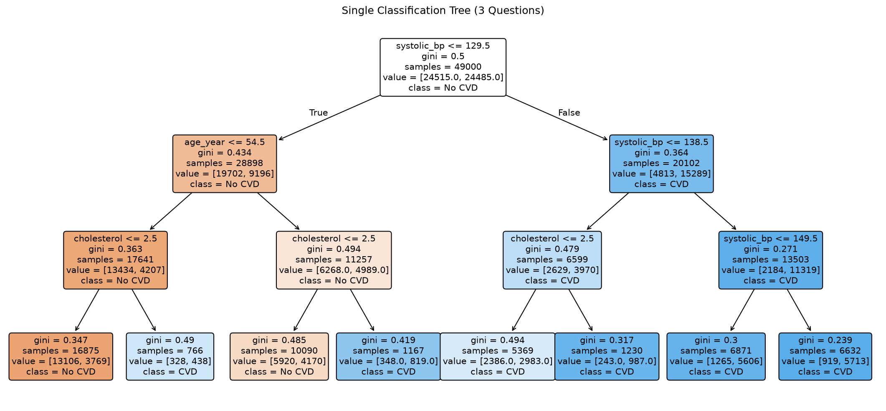
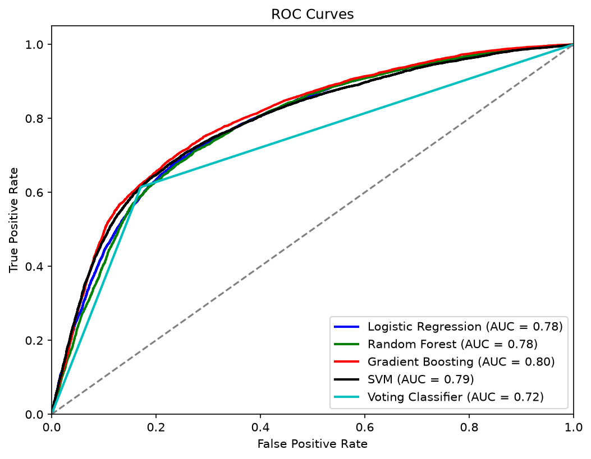
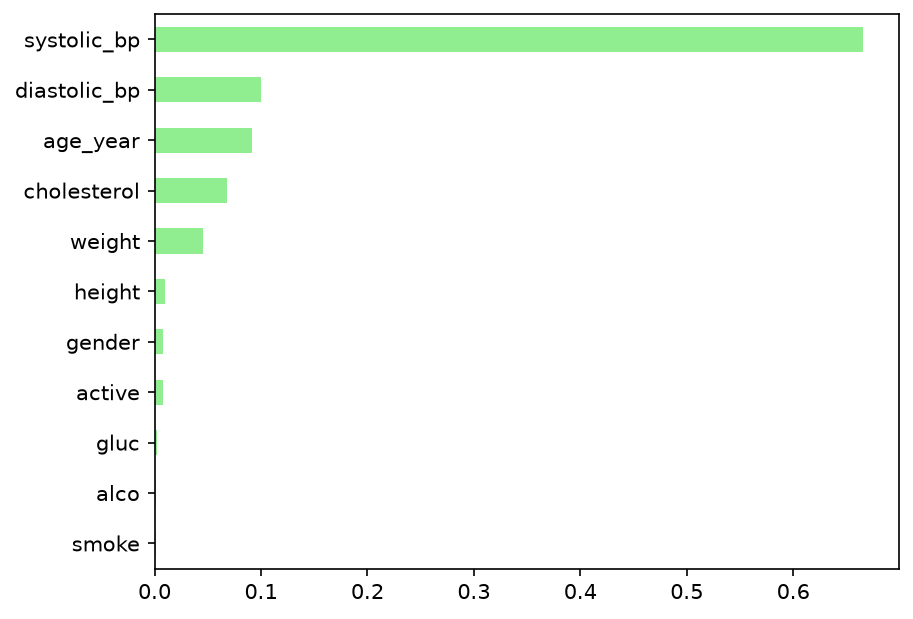

# ❤️ Cardiovascular Disease Prediction with Classification Tree Models

## 📌 Project Overview

This project uses Python and classification tree models to predict cardiovascular disease (CVD) from routine patient information. The dataset covers **70,000 patients** with age, sex, height, weight, blood pressure, cholesterol, glucose, smoking, alcohol use, physical activity, and CVD status. The classes are balanced: 35,021 patients without CVD and 34,979 with CVD.

I trained Logistic Regression, Random Forest, Gradient Boosting, and Support Vector Machine models, combined them in a voting classifier, and compared which risk factors each model relied on. I then went further. I audited the data for impossible readings, tuned the tree models, built a single classification tree with only three questions, and fixed how the voting classifier was scored.

The main findings: **tuned tree models reached 73.7% accuracy and an AUC of 0.804**, and **a single tree's first question was "Is systolic blood pressure 129.5 mmHg or lower?"**, which is essentially the 130 mmHg threshold for stage 1 hypertension in the ACC/AHA guidelines. The model found the clinical guideline on its own.

## 🎯 Key Features

✅ Data Preparation: Converted age from days to years, recoded sex, and encoded cholesterol, glucose, alcohol, and activity as numbers. 
✅ Model Comparison: Trained Logistic Regression, Random Forest, Gradient Boosting, and Support Vector Machine classifiers. 
✅ Ensemble Learning: Combined all four models in a voting classifier. 
✅ Model Evaluation: Compared accuracy, precision, recall, F1-score, and ROC AUC, with ROC curves for every model. 
✅ Feature Importance: Ranked risk factors with Random Forest, Gradient Boosting, and SVM, then combined them on a common scale. 
✅ Clinical Plausibility Audit: Flagged 1,416 records with impossible blood pressure, height, weight, or BMI values. 
✅ Clean Data Comparison: Measured how impossible readings affect linear models and tree models differently. 
✅ Tree Tuning: Showed that the original settings kept the trees too small, and tuned them. 
✅ Single Classification Tree: Built a three-question tree and compared it with a one-question clinical rule. 
✅ Soft Voting: Rescored the voting classifier with averaged probabilities so its AUC could be measured properly.

## 📷 Visualizations

### Single Classification Tree (3 Questions)

### ROC Curves

### Combined Feature Importance

## 🗂️ Repository Files

| File | Description |
|------|-------------|
| `cardio_data.csv` | Raw dataset: 70,000 rows and 13 columns of patient records |
| `cvd_classification_tree_models.ipynb` | Jupyter Notebook with the full code, models, and outputs |
| `single_classification_tree.png` | Three-question classification tree |
| `roc_curves.png` | ROC curves and AUC for all five models |
| `combined_feature_importance.png` | Risk factors ranked across three models |

## 🧹 Data Preparation

- Loaded the data with `pd.read_csv()` using a relative file path, so the notebook runs from any computer.
- Confirmed the dataset has no missing values.
- Converted age from days to years.
- Recoded sex so that 0 is female and 1 is male (45,530 women and 24,470 men).
- Converted cholesterol and glucose from "normal / high / very high" to 1, 2, and 3, and alcohol use and physical activity from "no / yes" to 0 and 1.
- Dropped the ID column and the original age in days, leaving **11 features**.
- Split the data 70/30 with `stratify=y` and `random_state=21`.
- Scaled the features inside a pipeline for Logistic Regression and the linear SVM. Tree models do not need scaling.
- Replaced the slow linear-kernel SVM with a scaled `LinearSVC`, which gave the same accuracy (72.5%) in seconds instead of more than 30 minutes.

## 🛠️ Skills & Tools Applied

- Language and Environment: Python, Jupyter Notebook (Anaconda)
- Libraries: pandas, NumPy, Matplotlib, Seaborn, scikit-learn
- Models: Logistic Regression, Random Forest, Gradient Boosting, Support Vector Machine, Decision Tree, Voting Classifier
- Evaluation: Accuracy, precision, recall, F1-score, ROC curves, ROC AUC
- Interpretation: Tree-based feature importance, SVM coefficients, combined importance, decision tree visualization
- Validation: Clinical plausibility audit, clean data comparison, hyperparameter tuning, clinical rule baseline
- Clinical Knowledge: ACC/AHA blood pressure staging, physiologic plausibility of vital signs

## 📈 Business Questions Answered

This project provides insights into:

- How well can routine patient data predict cardiovascular disease?
- Which tree model performs best, and how much does tuning matter?
- Which risk factors drive the predictions?
- Can a simple tree with a few questions compete with complex models?
- Do impossible readings in the data change the results?
- Does combining models into an ensemble improve predictions?

## 💡 Key Insights

### Model Comparison (21,000 test patients)

| Model | Accuracy | Precision | Recall | F1 | ROC AUC |
|---|---|---|---|---|---|
| Logistic Regression | 72.1% | 74.2% | 67.8% | 70.8% | 0.784 |
| Random Forest | 71.5% | 75.2% | 64.1% | 69.2% | 0.780 |
| **Gradient Boosting** | **72.7%** | 77.0% | 64.8% | 70.4% | **0.796** |
| Support Vector Machine | 72.3% | 77.8% | 62.3% | 69.2% | 0.786 |
| Voting Classifier (hard) | 72.2% | 78.2% | 61.4% | 68.8% | 0.722* |

- **Gradient Boosting performed best** with the original settings, even though each of its trees asked only one question.
- **Combining the models did not help.** The voting classifier scored 72.2%, below Gradient Boosting alone. The models made similar mistakes, so voting had little to correct.

*\*The voting classifier's AUC was calculated from yes/no predictions, not probabilities, so it cannot be compared with the others. See Soft Voting below.*

### Tuning the Tree Models

| Model | Accuracy | Recall | ROC AUC |
|---|---|---|---|
| Random Forest (original: `min_samples_leaf=0.12`) | 71.5% | 64.1% | 0.780 |
| Random Forest (tuned: `min_samples_leaf=50`, 200 trees) | 73.5% | 69.3% | 0.802 |
| Gradient Boosting (original: `max_depth=1`) | 72.7% | 64.8% | 0.796 |
| **Gradient Boosting (tuned: `max_depth=3`, 200 trees)** | **73.7%** | **69.7%** | **0.804** |

- The original Random Forest required every leaf to hold 12% of the training patients, which kept the trees very shallow. **Tuning raised its accuracy by 2 points and its recall by 5 points.**
- Tuned Gradient Boosting reached an **AUC of 0.804**, matching the 0.802 from my earlier LightGBM model on the same data. About 0.80 appears to be the ceiling for these features.

### Single Classification Tree vs. a Clinical Rule

| Approach | Accuracy | ROC AUC / Recall |
|---|---|---|
| Single tree, 3 questions | 72.5% | AUC 0.779 |
| Rule: systolic 130 mmHg or higher | 71.3% | Recall 62.2% |

- **The tree's first question was systolic blood pressure at 129.5 mmHg**, essentially the ACC/AHA threshold of 130 for stage 1 hypertension. Its next questions were age (54.5 years), cholesterol, and higher systolic cutoffs.
- A tree with just three questions matched the original Random Forest (72.5% vs. 71.5%), and **a one-question blood pressure rule reached 71.3%**.

### What Drives the Predictions

| Feature | Combined Importance |
|---|---|
| Systolic blood pressure | **66.6%** |
| Diastolic blood pressure | 10.0% |
| Age | 9.2% |
| Cholesterol | 6.8% |
| Weight | 4.5% |
| All others | About 3% combined |

- **Systolic blood pressure was the strongest predictor in every model.**
- **Smoking, alcohol use, and physical activity together accounted for about 1%.** These are known heart disease risk factors, but here they are self-reported yes/no answers, so they carry little signal compared with measured values.
- The same SVM ranked features very differently on unscaled data, where cholesterol came first. Scaling the data first gave a ranking that matched the tree models.

### Clinical Plausibility Audit

| Check | Records Found |
|---|---|
| Systolic outside 70 to 250 mmHg | 229 |
| Diastolic outside 40 to 150 mmHg | 1,034 |
| Diastolic equal to or higher than systolic | **1,236** |
| Height under 120 cm | 52 |
| Weight under 30 kg | 7 |
| BMI under 13 or over 60 | 76 |

- **1,416 records (2.0%)** failed at least one check. The highest readings were a systolic of **16,020** and a diastolic of **11,000** mmHg, most likely data entry errors.
- Removing them **improved Logistic Regression** (AUC 0.784 to 0.791) but **barely changed Gradient Boosting** (0.796 to 0.794). A tree only asks whether a value is above or below a cutoff, so it does not matter how extreme the value is.
- The bad readings also inflated the SVM's systolic coefficient from **0.98 to 5.73**.

### Soft Voting

| Voting Method | Accuracy | ROC AUC |
|---|---|---|
| Hard voting (counts yes/no votes) | 72.2% | 0.722 |
| **Soft voting (averages probabilities)** | **72.9%** | **0.796** |

- With soft voting, the ensemble's true AUC was **0.796**, in line with the individual models. The original 0.722 reflected how it was scored, not how well it performed.

*Note: The dataset does not include diagnosis dates or follow-up, so the models identify patients who have CVD rather than predicting future risk. The impossible readings documented above were kept in the main models to match the original analysis and were tested separately. This project is for learning purposes and is not a clinical tool.*

## 🚀 Learning Outcomes

Building this project strengthened my skills in:

📌 Understanding classification tree models in machine learning 
📌 Preprocessing and cleaning healthcare data for predictions 
📌 Building and training Decision Tree, Random Forest, and Gradient Boosting classifiers 
📌 Evaluating models with accuracy, precision, recall, F1-score, and ROC AUC 
📌 Analyzing feature importance to understand key risk factors 
📌 Tuning tree depth and leaf size, and seeing how much they change results 
📌 Combining models with hard and soft voting 
📌 Checking whether medical data is clinically plausible before trusting it

## 🔮 Next Steps

- Remove implausible records before training in the main pipeline.
- Tune the tree models with cross-validated grid search instead of a single test split.
- Add BMI and blood pressure stage as model features.
- Lower the decision threshold to catch more CVD cases for a screening use case.
- Check performance across subgroups such as age and sex.

## 📚 Dataset Source

Based on the [Cardiovascular Disease Dataset](https://www.kaggle.com/datasets/sulianova/cardiovascular-disease-dataset) by Svetlana Ulianova on Kaggle, using a cleaned version with labeled categories.

## 🙌 Acknowledgment

This project taught me that the most useful model is not always the most complex one. A tree with three questions rediscovered the blood pressure threshold that clinicians already use, and tuning mattered more than adding models to an ensemble. Seeing machine learning arrive at a clinical guideline on its own made both feel more trustworthy.

## 🔗 Related Link

[LinkedIn Post](https://www.linkedin.com/in/YOUR-POST-LINK)

## 👨‍💻 Author

**Omar Shazley**: Data Analyst | Python, Excel, SQL, and healthcare data analytics

💼 [LinkedIn](https://www.linkedin.com/in/omar-shazley-914a16b1/) 
💻 [GitHub Portfolio](https://github.com/Bromar95) 
📧 Email: [omarshazley@gmail.com](mailto:omarshazley@gmail.com)

✨ If you like this project, don't forget to ⭐ star the repo!
